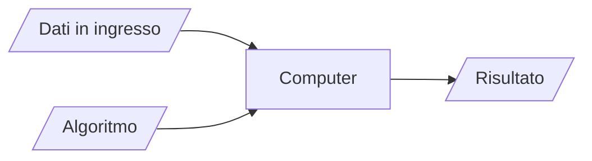
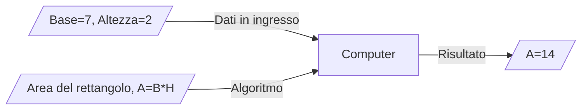
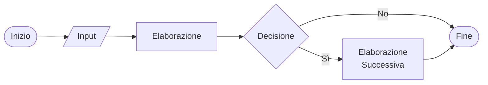
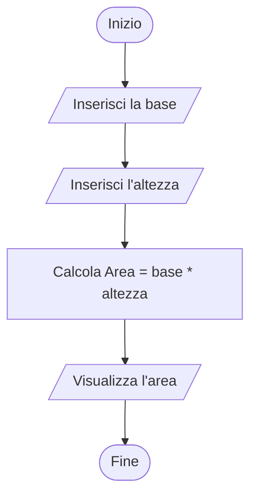
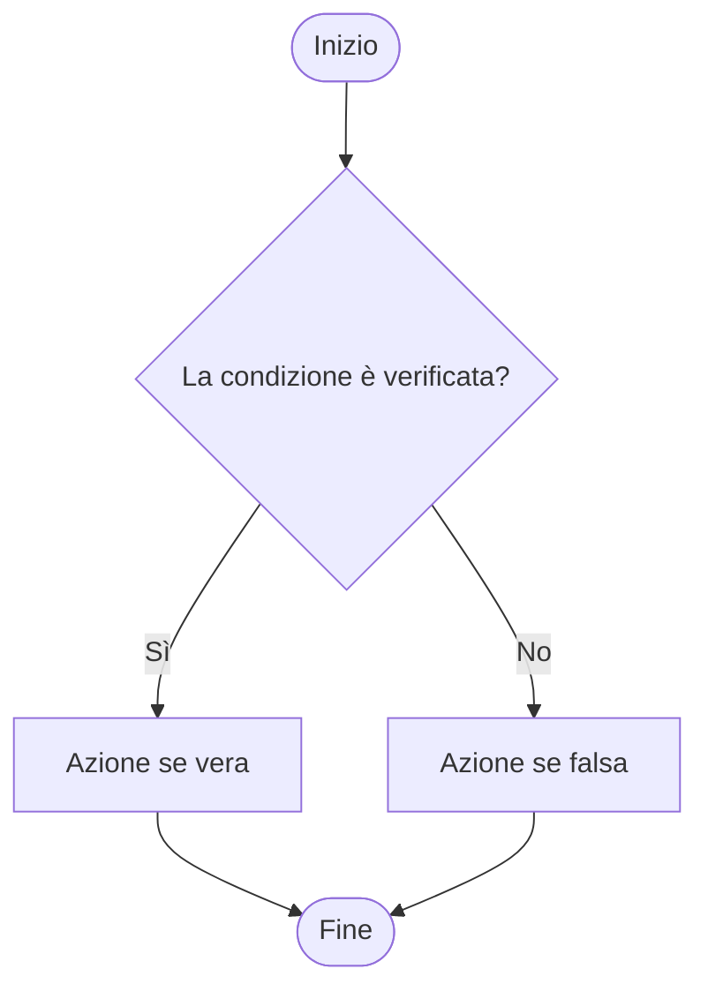
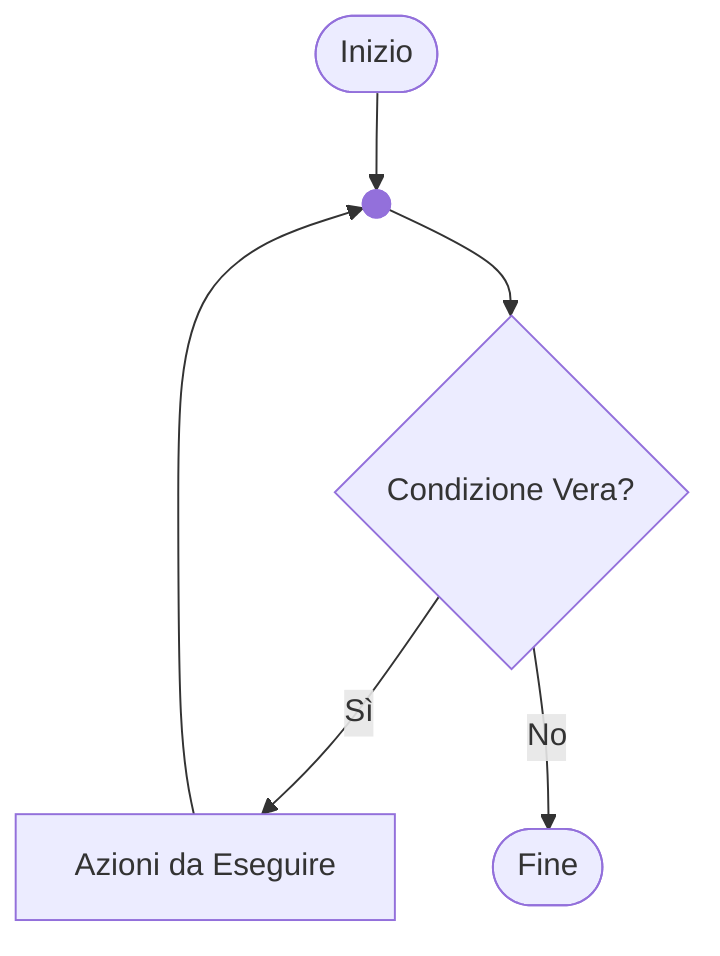
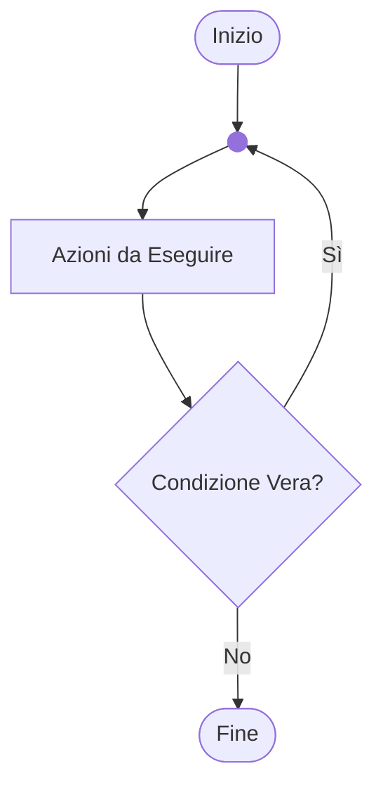
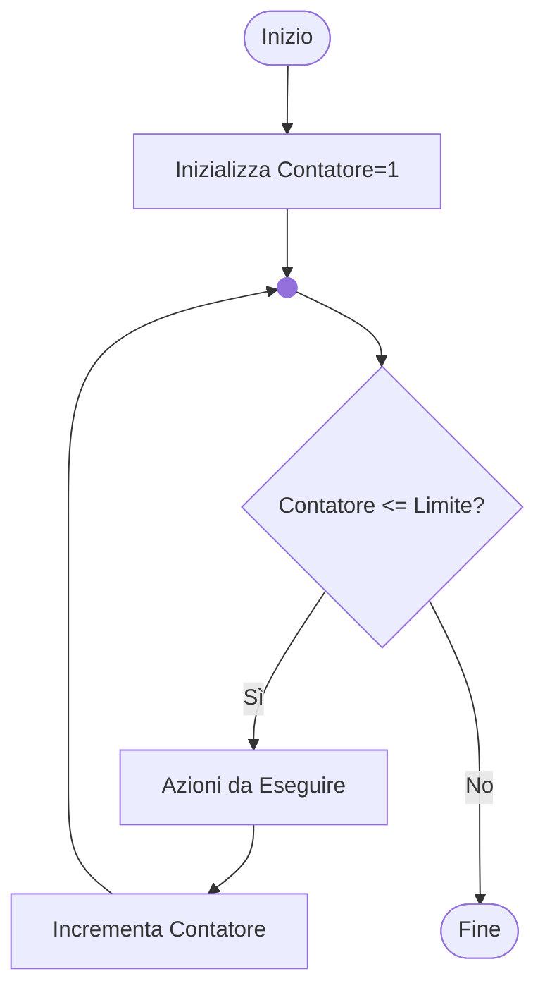
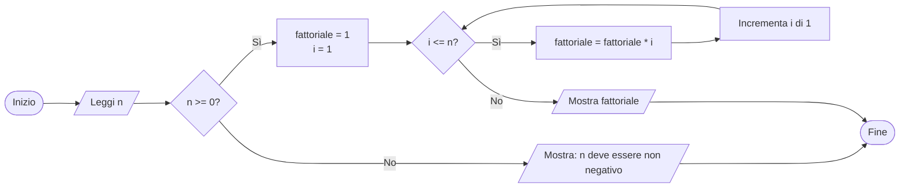
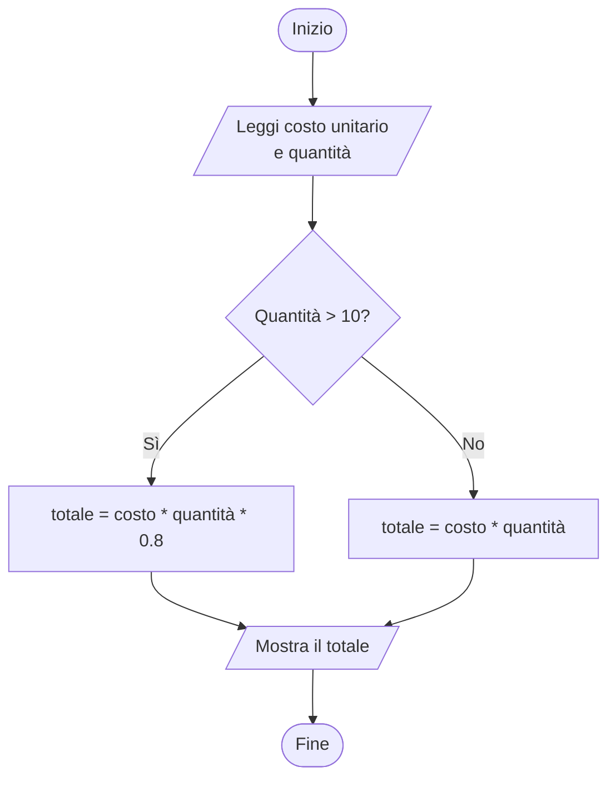

# 1 - Fondamenti di informatica e primo programma

Ing. Giancarlo Degani

---
level: 2

---

# Il corso

- **Programma:**
  - Prima parte: cultura informatica
  - Seconda parte: programmazione in linguaggio 'C'
- **Durata:** 30 ore (7 lezioni da 4 ore e 1 da 2 ore)
- **Verifica:** test finale di 20 domande a risposta multipla
  - 10 domande di teoria: 1 punto ciascuna
  - 10 domande su un esempio di codice da interpretare: 2 punti ciascuna

---
level: 2

---

# Strumenti

- Dispense delle lezioni
- Classroom
- CLion

---
layout: image-right
image: /clion1.png
level: 2

---

# CLion

- [CLion Download](https://www.jetbrains.com/clion/)
- [Educational license](https://www.jetbrains.com/community/education/#students/)

---
layout: image-right
image: /clion_license.png
level: 2

---

# Licenza per studenti

- Creare un account con l’email **@itsmeccatronico.it** e richiedere una licenza educational
- Scaricare ed installare CLion
- Aprire il programma e registrare la licenza inserendo le credenziali dell’account in **Help > Register**
- <https://www.jetbrains.com>

---
level: 2

---

# Riferimenti

- <https://cppreference.com/w/c.html>
- <https://en.wikibooks.org/wiki/C_Programming>

---
level: 2

---

# Pair programming

**Tecnica collaborativa di sviluppo software**

Due programmatori lavorano insieme allo stesso computer per scrivere codice.

**Vantaggi:**

- Qualità del codice superiore (revisione continua)
- Apprendimento reciproco e condivisione di conoscenze
- Meno errori e bug
- Problem solving più veloce
- Maggiore concentrazione

**Durante le esercitazioni in aula lavorerete in coppia seguendo questa metodologia.**

- Le coppie possono cambiare durante il corso.
- Entrambi devono comprendere e saper spiegare il codice prodotto.

---
level: 2

---

# Pair programming: driver

## 🖥️ Driver (Pilota)

**Chi siede davanti al computer**

- Scrive il codice alla tastiera
- Si concentra sulla sintassi e sui dettagli tecnici
- Implementa ciò che viene discusso
- **Focus tattico**: come scrivere il codice

---
level: 2

---

# Pair programming: navigator

## 🧭 Navigator (Navigatore)

**Chi guida e supervisiona**

- Pensa alla strategia generale e all'architettura
- Rivede il codice in tempo reale
- Suggerisce miglioramenti e alternative
- Anticipa problemi e casi limite
- **Focus strategico**: cosa scrivere e perché

**⏱️ Importante:** Scambiatevi i ruoli ogni 15-20 minuti!

Le coppie e i ruoli ruotano durante il corso, così tutti possono lavorare sia alla tastiera sia nella progettazione.

---
level: 2

---

# Algoritmo

- Il termine deriva dalla trascrizione latina del nome di al-Khwarizmi, matematico persiano vissuto nel IX secolo d.C.
- In matematica e informatica, un algoritmo è la specificazione di una sequenza finita di operazioni (dette anche istruzioni) che consente di risolvere una classe di problemi specifici o di calcolare il risultato di un'espressione matematica.

---
layout: image-right
image: /pancake.png
level: 2

---

# Ricetta

- Input:
  - Lista di ingredienti
  - Procedimento da eseguire
- Output:
  - Pancake

---
level: 2

---

# Proprietà di un algoritmo

- **Finito:** costituito da un numero finito di istruzioni.
- **Deterministico:** con gli stessi dati di ingresso e nelle stesse condizioni, produce lo stesso risultato.
- **Generale:** applicabile a tutti i problemi della classe a cui si riferisce.
  - Ad esempio, l'algoritmo per il calcolo dell'area di un rettangolo deve essere applicabile a tutti i rettangoli.
- **Eseguibile:** esiste un esecutore in grado di eseguire tutte le istruzioni in un tempo finito.

Non tutti gli algoritmi devono essere deterministici: questa proprietà è importante quando si vuole ottenere un risultato riproducibile.

---
layout: image-right
image: /human_computer.png
level: 2

---

# Caratteristiche degli esecutori

- Il linguaggio che possono comprendere (italiano, inglese, C, TypeScript, ecc.)
- Le azioni che possono eseguire
- Le regole che associano alle istruzioni fornite le azioni da eseguire

---
level: 2

---

# Calcolatore come esecutore

<br>
<br>
<br>



---
level: 2

---

# Esempio: area di un rettangolo come algoritmo

<br>
<br>
<br>



---
level: 2

---

# Variabili e tipi di dato

- Una variabile contiene un valore durante l'esecuzione di un programma.
- Le variabili:
  - Hanno un nome o identificatore.
  - Possono essere usate come parte di una istruzione.
  - Hanno un tipo di dato, che stabilisce quali valori possono contenere.
    - Ad esempio: numeri interi, numeri reali o caratteri.
- Le strutture dati sono organizzazioni più complesse di dati e verranno introdotte nelle lezioni successive.

---
level: 2

---

# Istruzioni di assegnazione

- Consentono di inserire un valore all’interno di una variabile.
- Cambiano a seconda del linguaggio utilizzato, ma solitamente usano l’operatore “=”.
  - x=5 assegna il valore 5 alla variabile x.
  - y=x assegna il valore contenuto nella variabile x alla variabile y.

---
level: 2

---

# Diagramma di flusso (flow chart)

- Consentono di rappresentare visivamente un algoritmo.
- Sono indipendenti dal linguaggio di programmazione.
- Esistono diversi standard grafici.

---
level: 2

---

# Esempio di flow chart



---
layout: image
image: /flowchart.png
backgroundSize: contain
title: Simboli flowchart
level: 2

---

<div class="absolute bottom-2 left-4 text-xs text-gray-400">
source: wikipedia.org
</div>

---
layout: two-cols
level: 2

---

# Esempio: area di un rettangolo

- Calcolo dell’area di un rettangolo
- Input: base ed altezza
- Algoritmo: Area = base * altezza

::right::



---
layout: two-cols
level: 2

---

# Selezione: if-then-else

- Viene valutata una condizione.
- Se la condizione è vera, l’elaborazione prosegue con il ramo di sinistra.
- Se la condizione è falsa, l’elaborazione prosegue con il ramo di destra.

::right::



---
layout: two-cols
level: 2

---

# Iterazione: ciclo while

- Viene valutata una condizione.
- Se la condizione è vera, viene eseguita l’azione e poi viene rivalutata la condizione.
- Si esce dal ciclo quando la condizione diventa falsa.

::right::



---
layout: two-cols
level: 2

---

# Iterazione: ciclo do while

- Viene eseguita l’azione.
- Se la condizione è vera, l’azione viene eseguita nuovamente e poi viene rivalutata la condizione.
- Si esce dal ciclo quando la condizione diventa falsa.
- Nel ciclo do-while l’azione viene eseguita almeno una volta.

::right::



---
layout: two-cols
level: 2

---

# Iterazione: ciclo for

- Viene valutata la condizione e, se vera, si esegue l’azione.
- L’azione viene eseguita un numero finito di volte.

::right::



---
layout: two-cols
level: 2

---

# Esempio: calcolo del fattoriale

Dato un numero intero, calcolarne il fattoriale.

- Input: un numero intero maggiore o uguale a zero
- Algoritmo: parto da 1 e moltiplico progressivamente il risultato per i numeri da 1 a n

::right::

<br>
<br>
<br>
<br>
<br>
<br>
<br>

$$
n! =
\begin{cases}
1 & \text{se } n = 0 \\
n \times (n-1) \times \cdots \times 2 \times 1 & \text{se } n > 0
\end{cases}
$$

---
layout: two-cols
level: 2

---

# Flow chart con Google Slides

1. Apri `slides.google.com` e crea una presentazione vuota
2. Condividi il file con il compagno, con permesso di modifica
3. Imposta il layout «Vuoto» sulla diapositiva
4. Inserisci le forme: «Inserisci → Forma → Forme», sezione «Diagramma di flusso»
5. Scrivi il testo con un doppio clic sulla forma
6. Collega le forme: «Inserisci → Linea → Connettore a gomito», agganciando i punti di connessione
7. Aggiungi Sì/No con una casella di testo

::right::

## Forme da usare

| Simbolo | Forma |
| --- | --- |
| Inizio, Fine | Terminatore |
| Elaborazione | Processo |
| Input, Output | Dati |
| Decisione | Decisione |

## Suggerimenti

- `Ctrl+D` duplica una forma
- I connettori seguono le forme quando le sposti

---
level: 2

---

# Esempio: flow chart del fattoriale



---
level: 2

---

# Esercizio: costo di un prodotto

Rappresentare un algoritmo per il calcolo del costo di un prodotto che soddisfi i seguenti requisiti:

- Input: costo unitario, quantità acquistata
- Se il numero di elementi acquistati è superiore a 10, applicare uno sconto del 20%
- Output: costo totale

---
layout: two-cols
level: 2

---

# Soluzione: flow chart del costo

Flowchart della soluzione

::right::



---
layout: center
level: 2

---

# “Algoritmi + Strutture Dati = Programmi”

## Niklaus Wirth

---
level: 2

---

# Programma e programmazione

- Il programma è una sequenza di istruzioni elementari che implementa un algoritmo e produce il risultato desiderato in un tempo finito.
- Il programma è scritto da un programmatore per risolvere un problema.
- La programmazione è il processo che porta alla realizzazione di un programma o software.

---
level: 2

---

# Problema

- Per fornire istruzioni a un computer è necessario utilizzare un linguaggio comune.
- La CPU esegue istruzioni macchina, rappresentate internamente in forma binaria.
- Il programmatore comprende il linguaggio naturale: “fai, leggi, scrivi.”
- Compilatori, interpreti e macchine virtuali traducono o eseguono il codice sorgente.

---
layout: image-right
image: /binary.png
level: 2

---

# Linguaggio macchina

Sequenza binaria comprensibile solo da uno specifico microprocessore o da una famiglia di microprocessori.

---
layout: two-cols
level: 2

---

# Linguaggio assembly

Stampa la scritta “hello world” in linguaggio assembly per microprocessore Intel 8086.

::right::

<<< @/snippets/example00/HelloWorld.asm asm {all}{lines:true}

---
layout: two-cols
level: 2

---

# Linguaggio C

Stampa la scritta “hello world”.

::right::

<<< @/snippets/example01/main.c c {all}{lines:true}

---
layout: two-cols
level: 2

---

# Linguaggio Python

Stampa la scritta “hello world” in Python.

::right::

<<< @/snippets/example00/hello.py py {all}{lines:true}

---
level: 2

---

# Linguaggi di programmazione

- Per livello di astrazione
  - Basso livello: vicini alla macchina (es. Assembly)
  - Alto livello: vicini al programmatore (es. C, Python)
- Per modalità di esecuzione
  - Compilati: tradotti in codice macchina (es. C)
  - Interpretati: eseguiti da un interprete (es. Python)

Il documento contenente le istruzioni scritte in un linguaggio di programmazione si chiama **codice sorgente**.

---
level: 2

---

# Traduttori ed interpreti

- **Interprete:** legge il codice o un formato intermedio e lo esegue durante l'esecuzione del programma (es. Python, JavaScript).
- **Compilatore:** traduce il codice in un formato eseguibile o intermedio, prodotto prima dell'esecuzione (es. C, C++, Rust).
- Un linguaggio può usare una combinazione di compilazione e interpretazione.
  - Java viene compilato in bytecode ed eseguito dalla macchina virtuale Java (JVM).

---
level: 2

---

# Pro e contro

In generale, precompilare parte del programma può ridurre il lavoro da svolgere durante l'esecuzione:

- un programma interpretato può analizzare il codice durante l'esecuzione;
- un programma compilato può riutilizzare il risultato della traduzione;
- compilatori e macchine virtuali possono ottimizzare il codice.

---
layout: image-right
image: /kernighan.png
level: 2

---

# Il linguaggio C

- Sviluppato da Dennis Ritchie ai Bell Labs nel 1972 per realizzare il sistema operativo UNIX
- Linguaggio compilato
- Compilatore disponibile per tutte le piattaforme
- Codice molto efficiente

---
level: 2

---

# Il linguaggio C, caratteristiche

- Adatto sia come linguaggio ad alto livello che a basso livello (operazioni sui bit)
- Tantissime librerie disponibili
- Linguaggio procedurale, non ad oggetti (Aggiunti nel C++)
- Gestione della memoria “manuale” (Non c’è garbage collector)

---
level: 2

---

# Librerie

- Il linguaggio C definisce una libreria standard con funzioni comuni, per esempio per l'input/output.
- Gli header, come `stdio.h`, dichiarano le funzioni disponibili, tra cui `printf()`.
- L'implementazione delle funzioni viene fornita dalle librerie e collegata al programma durante il linking.

---
level: 2

---

# Come si scrive un programma?

- Bastano un editor di testo per scrivere il file sorgente ed un compilatore o interprete per tradurre il sorgente in linguaggio macchina
- Solitamente si usa uno strumento definito Integrated Development Environment (IDE)
- CLion è un IDE specifico per C/C++

---
level: 2

---

# hello, world: il programma

<<< @/snippets/example01/main.c txt {all}{lines:true}

---
level: 2

---

# hello, world: passo per passo

<<< @/snippets/example01/main.c c {all|1-4|6-7|9-15|17-18|19|all}{lines:true}

---
level: 2

---

# Esercizio: il tuo primo programma in CLion (parte 1)

**Obiettivo:** Creare ed eseguire il programma "Hello, World!" usando CLion

**Passi da seguire:**

1. Apri CLion
2. Crea un nuovo progetto: `File → New Project`
3. Seleziona **C Executable**
4. Imposta le seguenti opzioni:
   - Nome progetto: `hello_world`
   - Linguaggio: **C**
   - Standard: **C11**
5. Clicca su **Create**

---
level: 2

---

# Esercizio: il tuo primo programma in CLion (parte 2)

6. Verifica che il file `main.c` contenga il codice Hello World
7. Clicca sul pulsante ▶️ verde (Run) oppure premi `Shift+F10` (Windows/Linux) o `Ctrl+R` (macOS)
8. Verifica l'output nella finestra **Run** in basso

**Risultato atteso nella console:**

```text
Hello, World!

Process finished with exit code 0
```

---
level: 2

---

# Creazione di un eseguibile

Il processo di creazione di un eseguibile a partire dai sorgenti è composto da 2 fasi:

- **compilazione**: il preprocessore espande le direttive come `#include`, poi il compilatore traduce il sorgente. Mancano ancora alcune parti (le "funzioni di base", come `printf`) e viene generato un file intermedio detto file oggetto
- **linking**: il file oggetto e le librerie vengono unite (collegate, "link") così da aggiungere le parti mancanti e costituire un unico file eseguibile. Il link può unire più file oggetto e più librerie.

Le fasi nel dettaglio sono in lezione 5.

---
level: 2

---

# Processo di build di un programma C

```mermaid {scale: 0.8, alt: 'Compilation pipeline diagram showing source files and headers flowing through preprocessor and compiler, then, with libraries, through the linker to create the executable'}
flowchart LR
SF@{ shape: doc, label: "Source file" }
HF@{ shape: docs, label: "Header files" }
SF-->PP[Preprocessor]
HF-->PP
PP-->PF@{ shape: doc, label: "Pre-processed file" }
PF-->CC[Compiler]
CC-->OF@{ shape: doc, label: "Object file" }

    OFF@{ shape: docs, label: "Object files" }-->LN[Linker]
    LL@{ shape: docs, label: "Libraries" }--> LN
    LN -->EF@{ shape: doc, label: "Executable file" }
```

---
layout: two-cols-small-header
level: 2

---

# Hello world in CLion

::left::

## 1. Crea

- `File → New Project → C Executable`
- Nome `hello_world`, standard C11
- CLion genera `main.c` e `CMakeLists.txt`

## 2. Compila

- `Build → Build Project` (`Ctrl+F9`, su macOS `⌘F9`)
- Compilatore e linker creano l'eseguibile nella cartella `cmake-build-debug`

::right::

## 3. Esegui

- Pulsante ▶ verde (Run): `Shift+F10`, su macOS `Ctrl+R`
- Se il sorgente è cambiato, Run compila di nuovo prima di eseguire

## Risultato nella finestra Run

```text
Hello, World!

Process finished with exit code 0
```

---
level: 2

---

# printf(): stampare testo

`printf()` stampa testo sullo standard output (terminale).

Alcuni caratteri speciali:

```c
printf("Line 1\nLine 2\n");     // \n = newline
printf("Tab\there\n");          // \t = tab
printf("Quote: \"\n");          // \" = double quote
printf("Backslash: \\\n");      // \\ = backslash
```

I valori numerici e la formattazione si vedono nella prossima lezione.

---
level: 2

---

# Esercizio: la scheda della macchina

Livello base, in coppia: scambiatevi i ruoli a metà esercizio.

Scrivere un programma che stampa con `printf()` esattamente questo testo:

```text
Machine: "Press 01"
Path: C:\factory\line1
Status: READY
```

## Suggerimento

Servono i caratteri speciali della slide precedente: `\n`, `\"` e `\\`.

## Per chi finisce prima

Stampare anche una quarta riga con un carattere di tabulazione tra `Status:` e `READY`.

---
level: 2

---

# Esercizio: il pannello di allarme

Livello standard, in coppia: scambiatevi i ruoli a ogni riga.

Scrivere un programma che stampa con `printf()` questo pannello, usando una sola istruzione `printf()` per riga:

```text
+------------------------+
| ALARM                  |
| Sensor: "T-04"         |
| Limit: 80 C            |
+------------------------+
```

## Suggerimento

Disegnare prima il pannello su carta e contare i caratteri di ogni riga. Le righe interne hanno la stessa lunghezza dei bordi.

## Per chi finisce prima

Stampare sotto il pannello il percorso `C:\factory\logs\alarm.txt` con le barre inverse.

---
level: 2

---

# Esercizio: il registro della misura

Scrivere un programma che stampa con `printf()` esattamente questo testo:

```text
--- Measurement ---
Sensor: "TEMP-01"
Location: Line A
Status: READY
-------------------
```

Usare una sequenza `\n` per ogni nuova riga e la sequenza `\"` per le virgolette.

---
level: 2

---

# Esercizio: il pannello di controllo

Scrivere un programma che stampa con `printf()` esattamente questo testo:

```text
+----------------------+
| LINE CONTROL         |
| Status: ACTIVE       |
| Sensor: OK           |
| Alarm: NONE          |
+----------------------+
```

Contare i caratteri di ogni riga per mantenere il pannello allineato.

---
level: 2

---

# Esercizio: la schermata diagnostica

Scrivere un programma che stampa con `printf()` esattamente questa schermata:

```text
========================
   MACHINE DIAGNOSTICS
========================
CPU:       OK
Memory:    OK
Sensor 01: OK
Alarm:     NONE
========================
```

Usare `\t` per allineare i valori quando possibile.

## Per chi finisce prima

Sostituire gli spazi con tabulazioni e verificare il risultato nella console.

---
level: 2

---

# Conclusioni: cosa porti a casa?

In coppia, senza consultare le slide, scrivete:

- tre cose che avete imparato oggi;
- una cosa che non avete ancora capito bene;
- una cosa che sapete spiegare al vostro compagno;
- una cosa che proverete nella prossima lezione.

Confrontate poi le vostre risposte con un'altra coppia.
