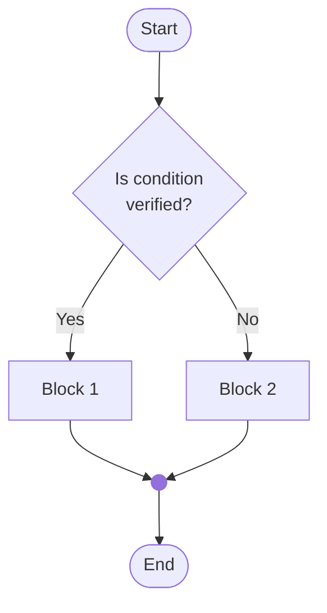
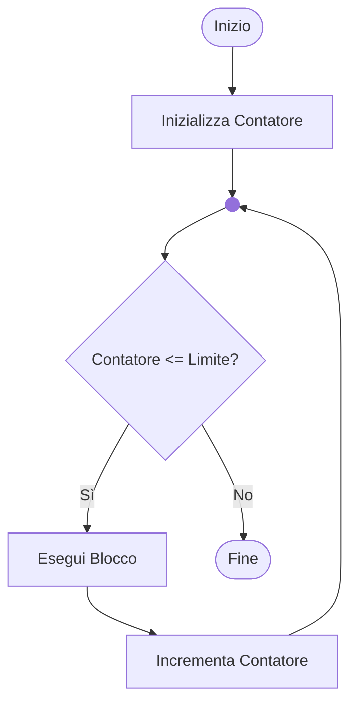
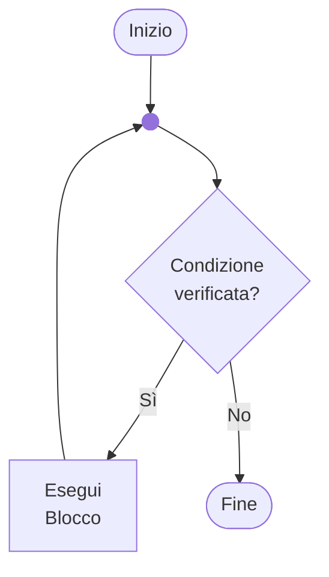
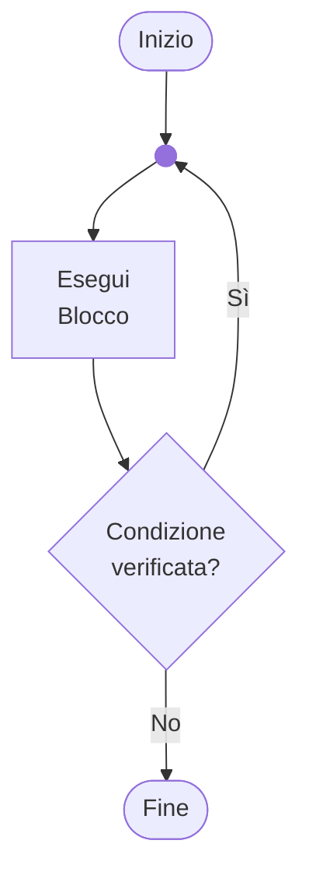

# 3 - Istruzioni condizionali e cicli

Ing. Giancarlo Degani

---
level: 2

---

# Controllo del flusso di esecuzione

Finora abbiamo visto programmi che eseguono le istruzioni in **sequenza** (una dopo l'altra).

Il controllo del flusso ci permette di:

## Esecuzione condizionale

Eseguire blocchi di codice **solo se** certe condizioni sono vere

- `if`, `if-else`, `switch`

## Esecuzione ripetuta (iterazione)

Ripetere blocchi di codice **più volte**

- `for`, `while`, `do-while`

Queste strutture sono fondamentali per scrivere programmi che prendono decisioni e automatizzano operazioni ripetitive.

---
level: 2

---

# Recap: vero e falso in C

Gli operatori relazionali e logici sono nella lezione 2. Qui conta un solo punto:

- `0` = falso
- qualsiasi valore ≠ 0 = vero

Una condizione può quindi essere anche un valore, non solo un confronto:

```c
int alarm = 1;                    // 1 = alarm active
float temperature = 92.5f;

if (alarm && temperature > 80) {  // both must be true
    printf("Stop the machine\n");
}
if (alarm) {                      // same as alarm != 0
    printf("Alarm is active\n");
}
```

---
layout: two-cols
level: 2

---

# Esecuzione condizionale: `if`

- Viene valutata una condizione
- Se la condizione è vera, l'elaborazione prosegue con il blocco di istruzioni
- Se la condizione è falsa, il blocco viene saltato

::right::

```mermaid {scale: 0.7, alt: 'Flowchart showing if statement control flow'}
flowchart TD
    Start([Start]) --> Condition{Is condition <br/> verified?}
    Condition -- Yes --> Action1[Action if True]
    Action1 -->   J@{ shape: f-circ, label: "Junction" }
    Condition -- No --> J
    J --> End([End])
```

---
level: 2

---

# Sintassi dell'istruzione `if`

## Forma base

```c
if (condition) {
    // statements executed if the condition is true
}
```

## Regole

- La **condizione** deve essere tra parentesi tonde `( )`
- Il **blocco** deve essere tra parentesi graffe `{ }` se contiene più istruzioni
- Se c'è una sola istruzione, le graffe sono opzionali (ma **raccomandate per chiarezza**)
- **Non** mettere `;` dopo la condizione!

---
layout: two-cols
level: 2

---

# Esempi di `if`

## IF con una sola istruzione

```c
if (condition)
    statement;
```

## IF con blocco di istruzioni

```c
if (condition) {
    statement_1;
    statement_2;
    statement_3;
}
```

::right::

## ⚠️ Errore comune

```c
// ❌ ERROR: ; after the condition
if (x > 0);  {
    printf("Positive\n");
}
// The block ALWAYS runs!
```

## ✅ Corretto

```c
if (x > 0) {
    printf("Positive\n");
}
```

---
level: 2

---

# Esempio pratico: `if`

Chiede un numero e, se è positivo, lo stampa.

Le parentesi `{}` sono richieste avendo un blocco di più istruzioni.

<<< @/snippets/example04/main.c#blocco_if c {*}{lines:true}

---
layout: two-cols
level: 2

---

# Esecuzione condizionale: `if-else`

- Se la condizione è verificata esegue il blocco 1
- Altrimenti esegue il blocco 2
- Permette di gestire esattamente due casi alternativi

::right::



---
layout: two-cols
level: 2

---

# Sintassi dell'istruzione `if-else`

```c
if (condition) {
    // block 1: executed if
    // the condition is true
} else {
    // block 2: executed if
    // the condition is false
}
```

::right::

## Esempio

```c
int age = 17;

if (age >= 18) {
    printf("You are an adult\n");
} else {
    printf("You are a minor\n");
}
// Output: You are a minor
```

---
level: 2

---

# `if-else` annidati (nested)

È possibile annidare più istruzioni if-else per gestire più di due casi:

<<< @/snippets/example54/main.c#demo c {*}{lines:true}

Lo stesso schema vale per una temperatura: normale, avviso, allarme.

<<< @/snippets/example53/main.c#demo c {*}{lines:true}

## Nota

- `else if` è in realtà un `else` seguito da un altro `if`
- La valutazione avviene dall'alto verso il basso
- Si ferma alla prima condizione vera

---
level: 2

---

# Quando usare `if`, `if-else` o `if` annidati

| Situazione | Struttura da usare | Esempio |
|------------|-------------------|---------|
| Una sola condizione da verificare | `if` | "Accendi la ventola se la temperatura è alta" |
| Due alternative mutualmente esclusive | `if-else` | "Macchina in marcia o ferma", "maggiorenne o minorenne" |
| Più di due alternative ordinate | `if-else if-else` | "Temperatura: normale, avviso, allarme", "voto" |
| Molte alternative su stesso valore | `switch` | "Stato della macchina", "menu con 5+ opzioni" |

---
level: 2

---

# Esercizio: carrello della spesa

Scrivere un programma per la gestione elementare di un carrello della spesa.

## Input richiesto

- Il numero di oggetti contenuti nel carrello
- Il prezzo unitario

## Calcoli da eseguire

- Se il numero di oggetti è maggiore di 10, applicare lo sconto del 10%
- Calcolare il costo al lordo dell'IVA del 22%

## Output

Stampare il dettaglio del carrello, l'imponibile, l'IVA, ed il totale lordo

---
level: 2

---

# Esercizio: output richiesto

```txt
===== Cart Details =====
Number of items: 12
Unit price: 200.00
Total before discount: 2400.00
Discount applied: 240.00
Taxable amount (after discount): 2160.00
VAT (22%): 475.20
Gross total: 2635.20
==============================
```

**Suggerimento:** Usa `if` per verificare se applicare lo sconto, poi calcola IVA e totale.

---
level: 2

---

# Esercizio: costo di un lotto di produzione

Stesso schema del carrello, applicato a un lotto di pezzi.

## Input richiesto

- Il numero di pezzi del lotto e il costo unitario di produzione
- Il costo fisso di attrezzaggio della macchina (150.00)

## Calcoli da eseguire

- Se il lotto supera i 500 pezzi, sconto del 5% sul costo dei pezzi
- Aggiungere il costo di attrezzaggio, poi l'IVA del 22%

## Esempio

```txt
Pieces: 800   Unit cost: 2.50
Parts cost: 2000.00   Discount: 100.00
Setup: 150.00   Taxable amount: 2050.00
VAT (22%): 451.00     Total: 2501.00
```

---
level: 2

---

# Selezione multipla: `switch`

Quando si devono gestire molti casi basati su un **singolo valore intero**, `switch` è più leggibile di tanti `if-else if`:

```c
switch (expression) {
    case value1:
        statements;
        break;
    
    case value2:
        statements;
        break;
    
    default:
        default statements;
}
```

---
level: 2

---

# Regole dello `switch`

## Caratteristiche

- L'**espressione** deve restituire un valore **intero** (char, short, int, long)
- I **valori** dei case devono essere **costanti** note a tempo di compilazione
- L'elaborazione inizia dal primo `case` che corrisponde al valore
- **break** è necessario per uscire dallo switch (altrimenti continua nei case successivi!)
- **default** è opzionale ed esegue se nessun case corrisponde

## ⚠️ Non dimenticare break

```c
int x = 2;
switch (x) {
    case 1: printf("Uno\n");    // Manca break!
    case 2: printf("Due\n");    // Eseguito
    case 3: printf("Tre\n");    // Eseguito anche questo!
}
// Output: Due, Tre (fall-through)
```

---
level: 2

---

# Esempio pratico: `switch`

Stato di una macchina letto da tastiera.

<<< @/snippets/example44/main.c#state c {*}{lines:true}

---
level: 2

---

# `switch`: più `case` per lo stesso blocco

È possibile avere più `case` che eseguono lo stesso blocco:

<<< @/snippets/example52/main.c#demo c {*}{lines:true}

---
layout: two-cols
level: 2

---

# Esercizio: menu con `switch`

**Obiettivo:** Creare un menu interattivo usando `switch` e `do-while`

**Requisiti:**

1. Crea un programma calcolatrice con menu
2. Mostra opzioni: 1=Somma, 2=Sottrazione, 3=Moltiplicazione, 4=Divisione, 5=Esci
3. Leggi due numeri dall'utente
4. Usa `switch` per eseguire l'operazione scelta
5. Usa `do-while` per ripetere fino a scelta "Esci"

::right::

**Esempio di esecuzione:**

```text
=== CALCULATOR ===
1. Add
2. Subtract
3. Multiply
4. Divide
5. Exit
Choice: 1
First number: 10
Second number: 5
Result: 15.00
```

---
level: 2

---

# Quando usare `if` o `switch`

| Criterio | IF-ELSE IF | SWITCH |
|----------|------------|--------|
| **Tipo di condizione** | Qualsiasi espressione booleana | Solo valori interi/char |
| **Complessità condizioni** | Condizioni complesse (range, combinazioni) | Valori esatti e costanti |
| **Leggibilità** | Meglio per 2-4 alternative | Meglio per 5+ alternative |
| **Performance** | Valutazione sequenziale | Può essere ottimizzato dal compilatore |

## Esempi

```c
// ✅ Use IF for ranges
if (age < 18) {...}
else if (age < 65) {...}

// ✅ Use SWITCH for exact values
switch (day_of_week) {
    case 1: ... // Monday
    case 2: ... // Tuesday
    ...
}
```

---
level: 2

---

# Iterazioni

## Problema

Visualizzare i numeri interi da 0 a 100

## Soluzione ingenua

```c
printf("0\n");
printf("1\n");
printf("2\n");
printf("3\n");
// ... 97 lines omitted ...
printf("100\n");
```

## ❌ Problemi

- Codice ripetitivo e difficile da mantenere
- Impossibile se il numero di iterazioni è variabile
- Errori di battitura

---
level: 2

---

# Iterazioni: introduzione

- Si parla di **iterazioni** quando una istruzione, o un blocco di istruzioni, vengono eseguite **più volte**
- Le strutture iterative sono comunemente dette **cicli** o **loop**
- Sono controllati da una **condizione di permanenza** nel ciclo
- C fornisce tre tipi di cicli:
  - **for**: quando si conosce il numero di iterazioni
  - **while**: quando la condizione è valutata prima dell'esecuzione
  - **do-while**: quando la condizione è valutata dopo l'esecuzione

---
layout: two-cols
level: 2

---

# Iterazioni: il ciclo `for`

Il ciclo **for** ripete l'esecuzione del blocco di istruzioni fintanto che la condizione è verificata.

## Sintassi

```c
for (initialization; condition; increment) {
    statements
}
```

## Esempio

```c
int i;
for (i = 0; i < 100; i++) {
    printf("%d\n", i);
}
```

::right::



---
level: 2

---

# Anatomia del ciclo `for`

```c
for (initialization; condition; increment) {
    statements
}
```

| Parte | Quando viene eseguita | Scopo |
|-------|----------------------|-------|
| **inizializzazione** | Una sola volta all'inizio | Imposta il valore iniziale del contatore |
| **condizione** | Prima di ogni iterazione | Decide se continuare il ciclo (1=sì, 0=no) |
| **incremento** | Dopo ogni iterazione | Modifica il contatore |
| **blocco** | Ad ogni iterazione (se condizione vera) | Operazioni da ripetere |

## Esempio annotato

```c
//     ↓ start       ↓ until when?     ↓ how to proceed?
for (int i = 0;     i < 10;            i++) {
    printf("%d\n", i);  // ← Eseguito 10 volte (i = 0,1,2,...,9)
}
```

---
level: 2

---

# Varianti del ciclo `for`

## Dichiarazione della variabile nel for (C99+)

```c
for (int i = 0; i < 10; i++) {  // i exists only in the loop
    printf("%d\n", i);
}
// printf("%d", i);  // ❌ ERROR: i does not exist here
```

## Incremento diverso

<<< @/snippets/example51/main.c#demo c {*}{lines:true}

---
layout: two-cols
level: 2

---

# Esercizio: Somma fino a un valore

**Obiettivo:** Usare un ciclo `for` per accumulare valori

**Requisiti:**

1. Chiedi all'utente un numero N
2. Calcola la somma di tutti i numeri da 1 a N
3. Stampa il risultato

**Esempio:**

```text
Enter N: 10
Sum from 1 to 10: 55
```

La somma è 1+2+3+4+5+6+7+8+9+10 = 55.

::right::

**Suggerimenti:**

- Usa `for (int i = 1; i <= n; i++)`
- Usa `sum += i` per accumulare
- Inizializza `sum = 0` prima del ciclo

---
layout: two-cols
level: 2

---

# Iterazioni: il ciclo `while`

- Esegue un blocco di codice **finché** una certa condizione è verificata
- Valuta la condizione **prima** di eseguire il blocco
- Se la condizione è inizialmente falsa, il blocco **non viene eseguito neppure una volta**

## Sintassi

```c
while (condition) {
    statements
}
```

::right::



---
layout: two-cols
level: 2

---

# Esempio: il ciclo `while`

Stampa i numeri da 0 a 1000.

Terminato il ciclo, il valore di `i` è 1001.

::right::

<Transform :scale="2">

<<< @/snippets/example03/ciclo_while.c#ciclo c {*}{lines:true}

</Transform>

---
layout: two-cols
level: 2

---

# Esempio: ciclo `while` con input

Somma dei valori introdotti finché non viene immesso il valore 0.

::right::

<Transform :scale="2">

<<< @/snippets/example03/ciclo_while2.c#ciclo c {*}{lines:true}

</Transform>

---
layout: two-cols
level: 2

---

# Equivalenza di `for` e `while`

`for` e `while` consentono di esprimere lo stesso comportamento.

I due esempi a fianco sono equivalenti.

::right::

<Transform :scale="2">

<<< @/snippets/example03/ciclo_for_while.c#ciclo c {*}{lines:true}

</Transform>

---
layout: two-cols
level: 2

---

# Iterazioni: il ciclo `do-while`

- Esegue un blocco di codice finché una certa condizione è verificata
- Valuta la condizione **dopo** aver eseguito il blocco
- Il blocco viene eseguito **almeno una volta**

## Sintassi

```c
do {
    statements
} while (condition);
```

**Nota:** Il `;` dopo `while` è obbligatorio!

::right::



---
layout: two-cols
level: 2

---

# Esempio: ciclo `do-while`

Stampa i numeri da 0 a 1000.

Anche questo esempio è equivalente ai precedenti, ma garantisce almeno una esecuzione.

::right::

<Transform :scale="2">

<<< @/snippets/example03/ciclo_do_while.c#ciclo c {*}{lines:true}

</Transform>

---
level: 2

---

# Esempio pratico: validazione PIN

Accesso al pannello di una macchina: tre tentativi, poi blocco.

<<< @/snippets/example41/main.c#pin c {*}{lines:true,maxHeight:'380px'}

---
level: 2

---

# `do-while`: caso d'uso tipico, il menu

Il caso d'uso più comune per `do-while` è un menu che deve essere mostrato almeno una volta:

<<< @/snippets/example46/main.c#menu c {*}{lines:true,maxHeight:'330px'}

---
level: 2

---

# Confronto tra i tre tipi di ciclo

| Caratteristica | FOR | WHILE | DO-WHILE |
|---------------|-----|-------|----------|
| **Controllo condizione** | Prima dell'esecuzione | Prima dell'esecuzione | Dopo l'esecuzione |
| **Minimo iterazioni** | 0 | 0 | 1 |
| **Uso tipico** | Iterazioni contate | Condizione complessa | Menu, validazione input |
| **Sintassi** | Compatta (tutto in una riga) | Più esplicita | Simile a while |

---
level: 2

---

# Esempio pratico: validazione input numerico

Lettura di una temperatura: si ripete finché il valore è un numero nel campo del sensore.

<<< @/snippets/example42/main.c#validation c {*}{lines:true,maxHeight:'330px'}

Mostra come usare `while`, `continue` e la validazione dell'input.

---
level: 2

---

# Controllo del flusso nei cicli: `break` e `continue`

## BREAK

Esce **immediatamente** dal ciclo (for, while, do-while, switch):

```c
for (int i = 0; i < 10; i++) {
    if (i == 5) break;  // Leaves when i is 5
    printf("%d ", i);
}
// Output: 0 1 2 3 4
```

## CONTINUE

Salta **l'iterazione corrente** e passa alla successiva:

```c
for (int i = 0; i < 10; i++) {
    if (i % 2 == 0) continue;  // Skip even numbers
    printf("%d ", i);
}
// Output: 1 3 5 7 9
```

---
level: 2

---

# Esempi pratici: `break` e `continue`

## Somma con continue (somma solo dispari)

```c
int sum = 0;
for (int i = 1; i <= 10; i++) {
    if (i % 2 == 0) continue;  // Skip even numbers
    sum += i;  // Add odd numbers only
}
printf("Odd sum: %d\n", sum);  // Output: 25 (1+3+5+7+9)
```

## Stampa con break (conteggio fino a limite)

<<< @/snippets/example50/main.c#demo c {*}{lines:true}

---
level: 2

---

# Esempio pratico: monitor di temperatura

Cinque letture: avviso sopra 80, allarme sopra 100 con `break`, minimo, massimo e somma.

<<< @/snippets/example43/main.c#monitor c {*}{lines:true,maxHeight:'380px'}

---
layout: two-cols
level: 2

---

# Cicli annidati (nested loops)

È possibile inserire un ciclo dentro un altro ciclo:

## Esempio: tabella di moltiplicazione

::right::

<Transform :scale="1.4">

<<< @/snippets/example03/ciclo_nested.c#ciclo c {*}{lines:true}

</Transform>

---
level: 2

---

# Cicli annidati: sensori e campioni

Il ciclo esterno scorre i sensori, quello interno i campioni di ciascun sensore.

<<< @/snippets/example45/main.c#nested c {*}{lines:true}

```text
Sensor 1: 25.5 26.0 26.5 27.0  | average 26.25
Sensor 2: 30.5 31.0 31.5 32.0  | average 31.25
Sensor 3: 35.5 36.0 36.5 37.0  | average 36.25
```

---
level: 2

---

# Esercizio: tabellina interattiva

<div class="exercise-box">

**Obiettivo:** Usare cicli annidati per creare una tabella

**Requisiti:**

Crea un programma che stampa la tavola pitagorica (tabellina) da 1 a 10.

**Output atteso:**

```text
    1   2   3   4   5   6   7   8   9  10
  ------------------------------------
1 |  1   2   3   4   5   6   7   8   9  10
2 |  2   4   6   8  10  12  14  16  18  20
3 |  3   6   9  12  15  18  21  24  27  30
...
10| 10  20  30  40  50  60  70  80  90 100
```

**Suggerimento:** Usa due cicli `for` annidati (uno per righe, uno per colonne)

</div>

---
level: 2

---

# Cicli annidati: il triangolo

## Stampa un triangolo

<<< @/snippets/example49/main.c#demo c {*}{lines:true}

---
level: 2

---

# Scope delle variabili nei cicli

## Variabile dichiarata nel for (C99+)

```c
for (int i = 0; i < 10; i++) {
    printf("%d ", i);  // ✅ i esiste qui
}
// printf("%d", i);  // ❌ ERROR: i does not exist outside the for
```

## Variabile dichiarata prima del ciclo

```c
int i;
for (i = 0; i < 10; i++) {
    printf("%d ", i);
}
printf("Final: %d\n", i);  // ✅ i is 10 (last increment)
```

## Buona pratica

- Dichiara le variabili nel for se non servono dopo
- Usa nomi descrittivi per cicli annidati (`row`, `col` invece di `i`, `j`)

---
layout: two-cols
level: 2

---

# Esercizio: verifica numero all'interno di un intervallo

**Obiettivo:** Usare `break` per uscire da un ciclo di ricerca

**Requisiti:**

1. Chiedi all'utente due numeri: limite inferiore e superiore
2. Chiedi all'utente un numero da cercare
3. Usa un ciclo `for` per contare da limite inferiore a superiore
4. Se trovi il numero, stampa il messaggio e usa `break`
5. Se il ciclo termina senza trovarlo, stampa "Non trovato"

::right::

**Esempio:**

```text
Lower bound: 1
Upper bound: 20
Number to find: 7
Output: Found the number 7!
```

**Suggerimento:** Usa una variabile `found` per tracciare se hai trovato il numero.

---
level: 2

---

# Errori comuni nei cicli

I cicli sono potenti ma anche una fonte frequente di bug. Ecco i problemi più comuni:

## 1. Errori off-by-one (OBOE - Off-By-One Error)

- Il ciclo esegue una iterazione in più o in meno del previsto
- Causato da condizioni `<` vs `<=` o inizializzazione errata

## 2. Cicli infiniti (Infinite loops)

- Il ciclo non termina mai perché la condizione rimane sempre vera
- Causato da dimenticanza dell'incremento o condizione mal formulata

## 3. Uso di variabili non inizializzate

- Comportamento imprevedibile se le variabili accumulo non sono inizializzate

## 4. Modifica dell'indice nel corpo del ciclo

- Alterare la variabile di controllo dentro il ciclo può causare comportamento inatteso

---
layout: two-cols
level: 2

---

# Errore off-by-one: esempi

```c
// I wanted to print from 1 to 10
for (int i = 0; i <= 10; i++) {
    printf("%d ", i);
}
// Output: 0 1 2 3 4 5 6 7 8 9 10  ❌ 11 numbers!
```

::right::

## ✅ Corretto: stampa da 1 a 10

<<< @/snippets/example48/main.c#demo c {*}{lines:true}

---
layout: two-cols
level: 2

---

# Cicli infiniti: esempi

## ❌ Dimenticato incremento

```c
int i = 0;
while (i < 10) {
    printf("%d\n", i);
    // ❌ Forgot i++!
}
// Infinite loop: prints 0 forever
```

## ❌ Condizione sempre vera

```c
int x = 5;
while (x > 0) {
    printf("x = %d\n", x);
    x = x + 1;  // ❌ Increases instead of decreasing!
}
// x becomes 6, 7, 8... never < 0
```

::right::

## ❌ Errore logico nella condizione

```c
int count = 0;
// ❌ Uses = instead of ==
while (count = 10) {  
    printf("Count: %d\n", count);
    count++;
}
// count = 10 assigns 10 (always true)
// and always prints 10!
```

## ✅ Corretto

```c
int i = 0;
while (i < 10) {
    printf("%d\n", i);
    i++;  // ✅ Increment present
}
```

---
level: 2

---

# Come evitare errori nei cicli

| Problema | Prevenzione | Esempio |
|----------|-------------|---------|
| **Off-by-one** | • Controlla condizione: `<` vs `<=`<br>• Pensa: "Quante iterazioni voglio?"<br>• Array: sempre `i < length` | `for (int i = 0; i < 10; i++)` per 10 elementi |
| **Ciclo infinito** | • Verifica che la condizione possa diventare falsa<br>• Assicurati che l'incremento vada nella direzione giusta | `while (x > 0)` → serve `x--` non `x++` |
| **Variabili non inizializzate** | • Sempre inizializzare variabili di accumulazione<br>• Contatori iniziano a 0, somme a 0, prodotti a 1 | `int sum = 0;` prima del ciclo |
| **Modifica indice nel ciclo** | • Non modificare la variabile di controllo del `for` nel corpo<br>• Usa variabili separate se necessario | Evita `for (int i = 0; i < n; i++) { i++; }` |

---
level: 2

---

# Debugging dei cicli: stampe di debug

## Tecniche per trovare errori

## 1. Stampe di debug strategiche

```c
// Before the loop: print the initial state
printf("=== LOOP START ===\n");
printf("Initial values: i=%d, sum=%d\n", i, sum);

for (int i = 0; i < 5; i++) {
    sum += i;
    // During: print at every iteration
    printf("Iteration %d: i=%d, sum=%d\n", i+1, i, sum);
}

// After: print the final result
printf("=== LOOP END ===\n");
printf("Final result: sum=%d\n", sum);
```

**Output aiuta a vedere cosa succede step-by-step!**

---
level: 2

---

# Debugging dei cicli: casi limite

## 2. Verificare i casi limite

- Primo e ultimo valore dell'indice
- Array vuoto (lunghezza 0)
- Un solo elemento

## 3. Contare le iterazioni a mano

- Simula 2-3 iterazioni su carta
- Verifica i valori delle variabili

## Esempio: media di N misure

```c
float average = sum / n;  // n == 0 ?
```

Con zero misure la divisione è per zero: controllare `n > 0` prima di dividere.

---
level: 2

---

# Il debugger di CLion

Un debugger permette di fermare il programma e osservarne l'esecuzione passo per passo.

1. **Breakpoint**: clic nel margine a sinistra della riga, dove il programma deve fermarsi
2. **Avvio**: *Debug* (icona con l'insetto) al posto di *Run*
3. **Passo per passo**:
   - *Step Over* (F8): esegue la riga corrente
   - *Step Into* (F7): entra nella funzione chiamata
   - *Resume* (F9): prosegue fino al prossimo breakpoint
4. **Variables** e **Watches**: valori delle variabili a ogni passo

---
level: 2

---

# Il debugger di CLion: demo sul ciclo

```c
int sum = 0;
for (int i = 1; i <= 5; i++) {
    sum += i;      // <-- breakpoint here
}
printf("%d\n", sum);
```

- Osservare `i` e `sum` a ogni iterazione con *Resume*
- *Breakpoint condizionale* (clic destro sul breakpoint): fermarsi solo quando `i == 4`
- In coppia: il *navigator* prevede il valore di `sum` prima di ogni passo, il *driver* controlla nella finestra *Variables*

---
level: 2

---

# Esercizio: trova gli errori

Identifica e correggi gli errori nei seguenti frammenti di codice:

```c
// 1. Sum of the first N numbers
int n = 10;
int sum;  // ❌ Error?
for (int i = 1; i <= n; i++) {
    sum = sum + i;
}

// 2. Print numbers from 1 to 10
for (int i = 0; i <= 10; i++) {  // ❌ Error?
    printf("%d ", i);
}
// I wanted to print from 1 to 10

// 3. Count down to zero
int count = 10;
while (count > 0) {
    printf("%d ", count);
    count = count + 1;  // ❌ Error?
}
```

---
level: 2

---

# Soluzioni esercizio

<<< @/snippets/example47/main.c#demo c {*}{lines:true}

---
level: 2

---

# Riepilogo: controllo del flusso

## Istruzioni condizionali

- **if**: esegue codice se condizione vera
- **if-else**: sceglie tra due alternative
- **if-else if**: gestisce più alternative ordinate
- **switch**: scelta multipla su valore intero

## Cicli (iterazioni)

- **for**: numero di iterazioni noto, contatore esplicito
- **while**: condizione valutata prima, 0+ iterazioni
- **do-while**: condizione valutata dopo, 1+ iterazioni

## Controllo cicli

- **break**: esce dal ciclo immediatamente
- **continue**: salta all'iterazione successiva

---
level: 2

---

# Best practices

## Scrittura di codice chiaro

1. **Indentazione consistente** - facilita lettura del codice annidato
2. **Usa parentesi graffe** - anche per blocchi di una sola riga
3. **Nomi variabili descrittivi** - `row`, `col` meglio di `i`, `j`
4. **Commenti quando necessario** - spiega il "perché", non il "cosa"
5. **Evita cicli troppo annidati** - massimo 2-3 livelli

## Testing

1. Testa i **casi limite** (0, 1, max)
2. Verifica i **casi normali** (valori tipici)
3. Controlla i **casi errati** (input non valido)

**Esercitati con esempi reali per consolidare i concetti!**

---
level: 2

---

# Esercizio: contatore pari e dispari

**Obiettivo:** Contare e sommare valori pari e dispari da input

**Requisiti:**

1. Chiedi all'utente di inserire una sequenza di numeri interi positivi
2. Termina quando l'utente inserisce 0
3. Conta quanti numeri pari e quanti dispari sono stati inseriti
4. Calcola la somma separata dei pari e dei dispari
5. Stampa i risultati

---
level: 2

---

# Esercizio: contatore pari e dispari, esempio

**Esempio di esecuzione:**

```text
Enter positive numbers (0 to stop):
Number: 12
Number: 5
Number: 8
Number: 7
Number: 14
Number: 3
Number: 0

Even numbers: 3 (sum: 34)
Odd numbers: 3 (sum: 15)
```

**Suggerimento:** Usa `if (num % 2 == 0)` per verificare se un numero è pari.

---
level: 2

---

# Esercizio: fattoriale con validazione

**Obiettivo:** Calcolare il fattoriale di un numero con validazione input

**Requisiti:**

1. Chiedi all'utente un numero intero tra 0 e 12
2. Se il numero non è valido, continua a chiederlo (usa `do-while`)
3. Calcola il fattoriale del numero (n! = 1 × 2 × 3 × ... × n)
4. Stampa il risultato
5. Nota: 0! = 1 per definizione

---
level: 2

---

# Esercizio: fattoriale con validazione, esempio

**Esempio di esecuzione:**

```text
Factorial calculation
Enter a number (0-12): 15
Error! Number too large. Try again.
Enter a number (0-12): -3
Error! Negative number. Try again.
Enter a number (0-12): 5

5! = 1 × 2 × 3 × 4 × 5 = 120
```

**Suggerimento:** Usa una variabile `factorial = 1` e moltiplica in un ciclo `for`.

---
level: 2

---

# Esercizio: verifica numero primo

<div class="exercise-box">

**Obiettivo:** Verificare se un numero è primo

**Requisiti:**

1. Chiedi all'utente un numero intero positivo maggiore di 1
2. Verifica se il numero è primo usando un ciclo
3. Un numero è primo se è divisibile solo per 1 e per se stesso
4. Stampa se il numero è primo o no
5. Bonus: mostra il primo divisore trovato se non è primo

**Esempio di esecuzione:**

```text
Enter a number: 17
17 is a prime number

Enter a number: 24
24 is not prime (divisible by 2)
```

**Suggerimento:** Usa un ciclo `for` da 2 a n-1 e controlla `if (n % i == 0)` per trovare divisori.

Vedi `example08` per la soluzione completa.

</div>
