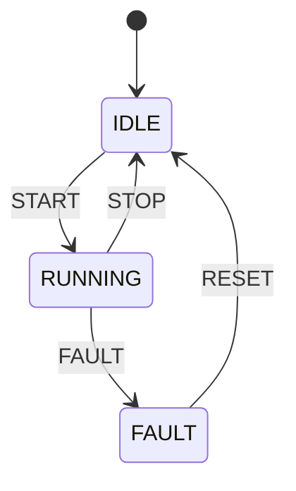

# 6 - Bit, enumerazioni e macchine a stati

Ing. Giancarlo Degani

---

# Codifiche numeriche

|Sistema|Base|Simboli|
|---|---|---|
|Binario|2|\{0,1\}|
|Ottale|8|\{0,1,2,3,4,5,6,7\}|
|Decimale|10|\{0,1,2,3,4,5,6,7,8,9\}|
|Esadecimale|16|\{0,1,2,3,4,5,6,7,8,9,A,B,C,D,E,F\}|

---

# Esempi

|Decimale|Binario|Esadecimale|
|---|---|---|
|2|10|2|
|10|1010|A|
|16|1 0000|10|
|255|1111 1111|FF|

---

# Codifica numerica posizionale

<br>

$$
n = \sum_{\substack{0 < i < m}} r_j \cdot b^j
$$

$$
1024 = 1 \times 10^3 + 0 \times 10^2 + 2 \times 10^1 + 4 \times 10^0 = 1024_{10}
$$

<br>

$$
10 = 1 \times 2^3 + 0 \times 2^2 + 1 \times 2^1 + 0 \times 2^0 = 1010_2
$$

<br>

$$
1024_{10} = 1 \times 2^{10} + 0 \times 2^9 + 0 \times 2^8 + 0 \times 2^7 + 0 \times 2^6 + 0 \times 2^5
\\+ 0 \times 2^4 + 0 \times 2^3 + 0 \times 2^2 + 0 \times 2^1 + 0 \times 2^0 = 100 0000 0000_2
$$

---
layout: two-cols

---

# Conversione IN BINARIO

- Per convertire un numero da base decimale a base binaria si utilizzano le operazioni di divisione intera e modulo (quoziente e resto):
  - Divido il numero per 2 e salvo il resto della divisione.
  - Ripeto fino a che il quoziente diventa zero.

$$
\begin{align*}
1972_{10} = 111;1011;0111_2
\end{align*}
$$

::right::

|N div B|N mod B||
|---|---|---|
|1972 / 2|986|0 ← LSB|
| 986 / 2  | 493    | 0       |
| 493 / 2  | 246    | 1       |
|…|…|…|
| 15 / 2   | 7      | 1       |
| 7 / 2    | 3      | 1       |
| 3 / 2    | 1      | 1       |
| 1 / 2    | 0      | 1 ← MSB |

---

# CONVERSIONE IN ESADECIMALE

- La stessa procedura usata per la conversione in binario può essere applicata anche alla conversione in base 16.
- Considerato che 16 è una potenza di 2, solitamente si converte prima in binario e poi si raggruppano i bit in gruppi di quattro (16 = 2⁴).

$${all}
255_{10} = 1111;1111_2 = FF_{16}
$$

---

# unità di misura

- In binario, l’unità di misura fondamentale è l’informazione rappresentabile con una sola cifra binaria, zero o uno, detta bit (Binary digIT).
- Una sequenza di 8 bit è definita Byte.

|Multipli|Valore|Valore|
|---|---:|---:|
|Kilobyte - KB|2<sup>10</sup>|1 024|
|Megabyte - MB|(2<sup>10</sup>)<sup>2</sup>|1 048 576|
|Gigabyte - GB|(2<sup>10</sup>)<sup>3</sup>|1 073 741 824|
|Terabyte - TB|(2<sup>10</sup>)<sup>4</sup>|1 099 511 627 776|

---

# Rappresentazione di interi in modulo e segno

- Supponiamo di avere un registro di 4 byte = 32 bit.
- I bit sono convenzionalmente numerati da 0 a 31 da destra verso sinistra, dove un indice maggiore corrisponde a un peso maggiore.
- Si utilizza il primo bit a sinistra per rappresentare il segno:
  - 0: numero positivo
  - 1: numero negativo
- I bit da 0 a 30 rappresentano il valore assoluto del numero.

---

# Rappresentazione di interi in modulo e segno

Si possono rappresentare i seguenti numeri:

- Positivi: da +0 a +2<sup>31</sup>-1 = 2.147.483.647
- Negativi: da -0 a -(2<sup>31</sup>-1) = -2.147.483.647

|Cifra|1|0|1|…|0|1|1|0|
|---|---|---|---|---|---|---|---|---|
|Indice|31|30|29|…|3|2|1|0|

---

# Il complemento a due

- Metodo per rappresentare numeri interi con segno nei computer.
- Calcolo del complemento a due:
  - Rappresentare il numero in forma binaria: 0000 0101 (5).
  - Invertire tutti i bit (sostituendo 0 con 1 e viceversa): 1111 1010
    - Ovvero eseguire il complemento a uno).
  - Aggiungere il valore 1: 1111 1011 (che rappresenta -5).

---

# Rappresentazione di interi in complemento a 2

- Nella codifica in complemento a due:
  - I numeri positivi sono rappresentati in modulo e segno.
  - I numeri negativi sono rappresentati in complemento a due.
- Con n bit si possono rappresentare numeri da -2<sup>n-1</sup> a 2<sup>n-1</sup>-1.
  - Con 8 bit, ad esempio, si possono rappresentare i numeri da -128 a +127.

---

# Codifica di caratteri

- La prima codifica utilizzata fu lo standard ASCII (American Standard Code for Information Technology).
- Prevedeva l’uso di 7 bit per rappresentare caratteri alfabetici, simboli grafici e alcuni caratteri speciali.
- Successivamente fu estesa a 8 bit.

---
layout: image
image: /ascii.png
backgroundSize: contain
title: Tabella ASCII

---

# Dal numero al registro

Un microcontrollore comanda l'hardware scrivendo **registri**: gruppi di 8, 16 o 32 bit, ognuno con un significato.

Un byte con valore `0xA5`:

| bit | 7 | 6 | 5 | 4 | 3 | 2 | 1 | 0 |
| --- | :-: | :-: | :-: | :-: | :-: | :-: | :-: | :-: |
| valore | 1 | 0 | 1 | 0 | 0 | 1 | 0 | 1 |

- Una cifra esadecimale corrisponde a **4 bit**: `A` = `1010`, `5` = `0101`
- Il bit 0 è il meno significativo, a destra
- In C l'esadecimale si scrive con il prefisso `0x`: `0xA5`, `0x0F`, `0xFF`

---

# Tipi a dimensione fissa: stdint.h

La dimensione di `int` dipende dalla macchina: 16 bit su molti microcontrollori, 32 bit su un PC. Per i registri serve una dimensione certa.

```c
#include <stdint.h>
```

| Tipo | Bit | Valori |
| --- | :-: | --- |
| `uint8_t` | 8 | 0 … 255 |
| `int8_t` | 8 | -128 … 127 |
| `uint16_t` | 16 | 0 … 65535 |
| `int16_t` | 16 | -32768 … 32767 |
| `uint32_t` | 32 | 0 … 4294967295 |
| `int32_t` | 32 | -2147483648 … 2147483647 |

Per i registri e per i dati binari si usano i tipi **senza segno** (`uint…`).

---

# Operatori bit a bit

Agiscono sui singoli bit di un intero, un bit alla volta.

| Operatore | Nome | Effetto |
| :-: | --- | --- |
| `&` | AND | 1 solo se entrambi i bit sono 1 |
| `\|` | OR | 1 se almeno un bit è 1 |
| `^` | XOR | 1 se i bit sono diversi |
| `~` | NOT | inverte ogni bit |
| `<<` | shift a sinistra | sposta i bit a sinistra |
| `>>` | shift a destra | sposta i bit a destra |

⚠️ Non confondere `&` con `&&` e `|` con `||`: i primi lavorano sui bit, i secondi sono operatori logici.

---
layout: two-cols-header

---

# Tabelle di verità bit a bit

::left::

| A | B | A `&` B |
| :-: | :-: | :-: |
| 0 | 0 | 0 |
| 0 | 1 | 0 |
| 1 | 0 | 0 |
| 1 | 1 | 1 |

| A | B | A `\|` B |
| :-: | :-: | :-: |
| 0 | 0 | 0 |
| 0 | 1 | 1 |
| 1 | 0 | 1 |
| 1 | 1 | 1 |

::right::

| A | B | A `^` B |
| :-: | :-: | :-: |
| 0 | 0 | 0 |
| 0 | 1 | 1 |
| 1 | 0 | 1 |
| 1 | 1 | 0 |

| A | `~`A |
| :-: | :-: |
| 0 | 1 |
| 1 | 0 |

---

# Esempi su 8 bit

```text
  1100 1010            1100 1010            1100 1010
& 0000 1111          | 0000 1111          ^ 0000 1111
  ---------            ---------            ---------
  0000 1010            1100 1111            1100 0101
```

```text
~ 1100 1010 = 0011 0101
```

Gli shift spostano i bit e riempiono con zeri:

```c
uint8_t x = 0x0B;      // 0000 1011
x << 2;                // 0010 1100 (0x2C): moltiplica per 4
x >> 1;                // 0000 0101 (0x05): divide per 2
1u << 3;               // 0000 1000 (0x08): il bit 3 acceso
```

---

# Operazioni su un singolo bit

Per agire sul bit `n` di una variabile `reg` si usa una **maschera** `(1u << n)`:

| Operazione | Codice | Effetto |
| --- | --- | --- |
| Set (accendere) | `reg \|= (1u << n);` | porta il bit a 1 |
| Clear (spegnere) | `reg &= ~(1u << n);` | porta il bit a 0 |
| Toggle (invertire) | `reg ^= (1u << n);` | inverte il bit |
| Test (leggere) | `if (reg & (1u << n))` | vero se il bit è 1 |

Gli altri bit non cambiano mai.

---
layout: two-cols

---

# Esempio: byte di stato di una macchina

Ogni bit del byte di stato ha un significato:

| Bit | Significato |
| :-: | --- |
| 0 | porta aperta |
| 1 | emergenza |
| 2 | motore attivo |
| 3 | allarme temperatura |

Le maschere hanno un nome, così il codice si legge.

::right::

<<< @/snippets/example31/main.c#snippet1 c {*}{lines:true}

---
layout: two-cols

---

# Byte di stato: operazioni

<<< @/snippets/example31/main.c#snippet2 c {*}{lines:true}

::right::

Output:

```text
start          00000000  (0x00)
motor, door    00000101  (0x05)
door closed    00000100  (0x04)
over temp      00001100  (0x0C)
ALARM: temperature too high
```

---
layout: two-cols

---

# Esempio: estrarre i campi da un frame

Una scheda con sensori invia un frame da 16 bit:

| Bit | Campo |
| :-: | --- |
| 15 … 12 | numero del sensore (4 bit) |
| 11 … 0 | valore dell'ADC (12 bit) |

- **Shift** per portare il campo in fondo
- **Maschera** `&` per tenere solo i suoi bit

::right::

<<< @/snippets/example32/main.c#snippet1 c {*}{lines:true}

---
layout: two-cols

---

# Esempio: i campi del frame

<<< @/snippets/example32/main.c#snippet2 c {*}{lines:true}

::right::

Output:

```text
frame     = 0x5A3C
sensor id = 5
raw value = 2620
voltage   = 2.111 V
new frame = 0x2A3C
```

---

# Cos'è un'enumerazione?

Le **enumerazioni** (enum) permettono di definire un insieme di costanti intere con nomi significativi.

## Problema senza enum

```c
#define LUNEDI 0
#define MARTEDI 1
#define MERCOLEDI 2
// ... difficile da gestire
```

## Soluzione con enum

```c
enum giorni_settimana {
    LUNEDI,     // 0
    MARTEDI,    // 1
    MERCOLEDI,  // 2
    GIOVEDI,    // 3
    VENERDI,    // 4
    SABATO,     // 5
    DOMENICA    // 6
};
```

---

# Enumerazioni: sintassi

## Sintassi generale

```c
enum nome_tipo {
    VALORE1,
    VALORE2,
    VALORE3
};
```

## Caratteristiche

- Per default, il primo valore è **0**
- Ogni valore successivo è **incrementato di 1**
- I nomi devono essere **unici** nello stesso scope
- Migliorano la **leggibilità** del codice
- Evitano "numeri magici" nel codice

---

# Assegnazione di valori espliciti

È possibile assegnare valori espliciti agli elementi di un enum:

```c
enum ErrorCode {
    OK = 0,
    WARNING = 100,
    ERROR = 200,
    CRITICAL = 300
};

enum HttpStatus {
    HTTP_OK = 200,
    HTTP_NOT_FOUND = 404,
    HTTP_ERROR = 500
};
```

## Regola

- Se assegni un valore esplicito, il successivo sarà `valore + 1`
- Puoi mescolare valori espliciti e automatici

---

# Enumerazioni: valori duplicati

I **nomi** devono essere unici, ma i **valori** possono ripetersi:

```c
enum Stato {
    SPENTO = 0,
    OFF = 0,        // Stesso valore di SPENTO
    ACCESO = 1,
    ON = 1          // Stesso valore di ACCESO
};
```

## Nota

- `SPENTO` e `OFF` hanno lo stesso valore (0)
- Utile per alias o compatibilità

---

# Enum con switch: esempio pratico

```c
#include <stdio.h>

enum Semaforo {
    ROSSO,
    GIALLO,
    VERDE
};

void stampa_azione(enum Semaforo stato) {
    switch (stato) {
        case ROSSO:
            printf("STOP - Non passare!\n");
            break;
        case GIALLO:
            printf("ATTENZIONE - Rallenta\n");
            break;
        case VERDE:
            printf("VIA LIBERA - Puoi passare\n");
            break;
        default:
            printf("Stato sconosciuto\n");
    }
}
```

---

# Typedef con enum

`typedef` crea un alias per semplificare l'uso dell'enum:

## Senza typedef

```c
enum boolean { FALSO, VERO };
enum boolean flag = VERO;  // Devi scrivere "enum boolean"
```

## Con typedef

```c
typedef enum { FALSO, VERO } boolean;
boolean flag = VERO;  // Più semplice!
```

## Esempio completo

```c
typedef enum {
    GENNAIO = 1, FEBBRAIO, MARZO, APRILE,
    MAGGIO, GIUGNO, LUGLIO, AGOSTO,
    SETTEMBRE, OTTOBRE, NOVEMBRE, DICEMBRE
} Mese;

Mese corrente = MARZO;  // Tipo Mese invece di enum Mese
```

---

# Macchine a stati

Una macchina ha un numero finito di **stati**. Un **evento** la fa passare da uno stato a un altro.



Esempio: il ciclo di un nastro trasportatore.

---

# Macchina a stati in C: stati ed eventi

- Gli **stati** e gli **eventi** sono due `enum`
- Una funzione riceve lo stato corrente e l'evento e restituisce il nuovo stato

<<< @/snippets/example33/main.c#snippet1 c {*}{lines:true}

---

# Macchina a stati in C: la transizione

Un `switch` sullo stato, un `if` sull'evento:

<<< @/snippets/example33/main.c#snippet3 c {*}{lines:true}

---
layout: two-cols

---

# Macchina a stati: simulazione

<<< @/snippets/example33/main.c#snippet2 c {*}{lines:true}

::right::

Output:

```text
start: IDLE
event 1 -> RUNNING
event 2 -> FAULT
event 3 -> FAULT
event 4 -> IDLE
event 5 -> RUNNING
event 6 -> IDLE
```

L'evento 3 (`START`) in stato `FAULT` viene ignorato: serve prima un `RESET`.

---

# Esercizio: validazione con enum

Crea un sistema di validazione età usando enum:

```c
typedef enum {
    MINORE,
    ADULTO,
    ANZIANO
} CategoriaEta;

CategoriaEta classifica_eta(int anni);
```

**Requisiti:**

- MINORE: età < 18
- ADULTO: 18 ≤ età < 65
- ANZIANO: età ≥ 65

**Bonus:** Usa switch per stampare un messaggio appropriato

---

# Esercizio in coppia: bit e macchine a stati

Partendo dagli esempi della lezione:

- **Base:** aggiungere al byte di stato un bit "finecorsa raggiunto" e scrivere le istruzioni per accenderlo, spegnerlo e leggerlo
- **Standard:** scrivere una funzione che estrae dal frame a 16 bit i due campi e li stampa; verificare con `0x1FFF` e `0xA001`
- **Sfida:** aggiungere alla macchina a stati lo stato `PAUSED` (da `RUNNING` con l'evento `PAUSE`, ritorno con `RESUME`) e simulare una sequenza di eventi

Ogni coppia lavora sul proprio portatile; ruoli di *driver* e *navigator* a rotazione.

---

# volatile

I registri hardware e le variabili modificate da un interrupt possono cambiare **fuori dal controllo del programma**.

<<< @/snippets/example35/main.c#snippet1 c {*}{lines:true}

- Senza `volatile` il compilatore, ottimizzando, potrebbe leggere la variabile una volta sola e non accorgersi del cambiamento
- Per ora ci basta riconoscerlo: lo ritroverete programmando microcontrollori

---

# Riepilogo: bit, enum e macchine a stati

- **Esadecimale**: una cifra = 4 bit; prefisso `0x`
- **`stdint.h`**: tipi a dimensione fissa (`uint8_t`, `uint16_t`, `uint32_t`)
- **Operatori**: `&`, `|`, `^`, `~`, `<<`, `>>`
- **Un bit**: set `|=`, clear `&= ~`, toggle `^=`, test `&`, sempre con una maschera `(1u << n)`
- **Campi di un frame**: shift e maschera
- **`enum`** per stati ed eventi; **`switch`** per le transizioni
- **`volatile`** per i valori che cambiano fuori dal programma
